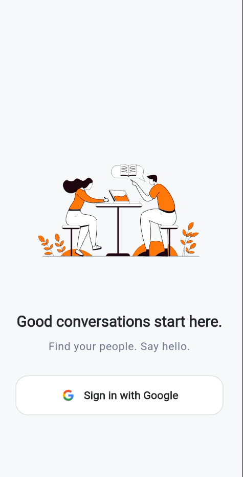
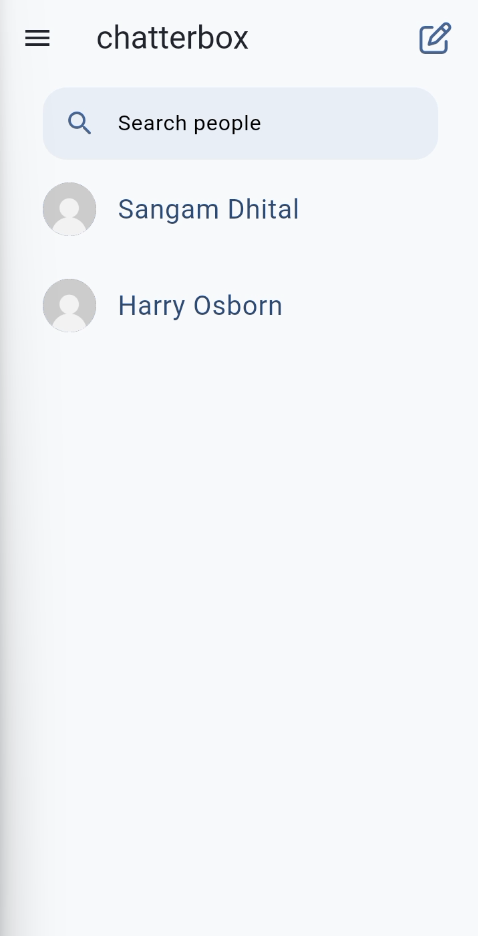
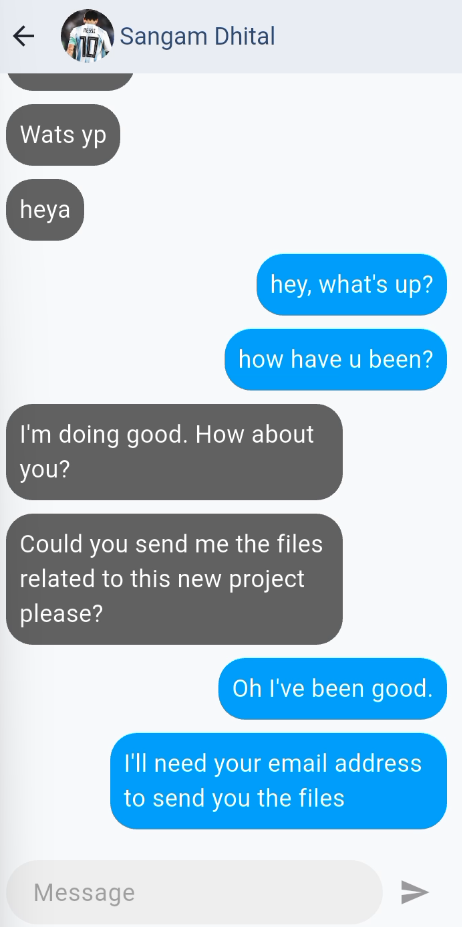

# ChatterBox

ChatterBox is a Flutter chat app for finding people and having one-to-one conversations. Sign in with Google, discover other users, and exchange messages in real time.

## Screenshots

  
  
  

## Features

- Google Sign-In
- Search for people and start one-to-one chats
- Real-time messaging over Socket.IO
- Light and dark themes

## Tech stack

- Flutter and Dart (Android client)
- Node.js and Express (API)
- MongoDB (user data)
- Socket.IO (real-time messaging)
- Riverpod (client state management)

## Configuration

Create a root `.env` for the Flutter app and a `server/.env` for the API. Set the API host and Google OAuth client IDs in the root file; set the MongoDB connection string, server port, and JWT secret in `server/.env`. These files contain local configuration and are excluded from Git.

For a physical Android device, set the API host to the computer's LAN IP address and keep the phone and computer on the same Wi-Fi network. Start the API from the `server` directory with `npm install` and `npm run dev`. Then, from the project root, run `flutter pub get` and `flutter run`.
